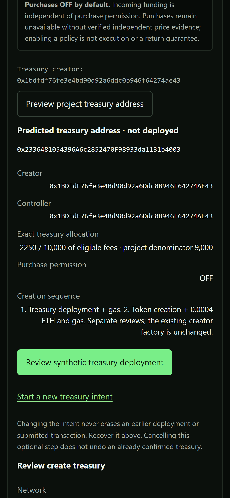
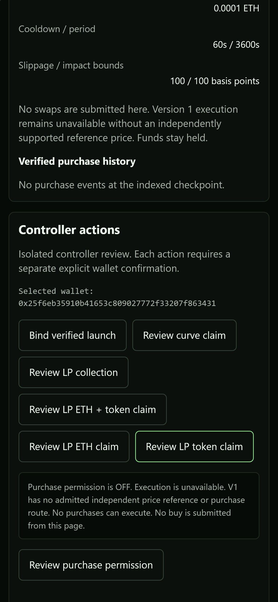
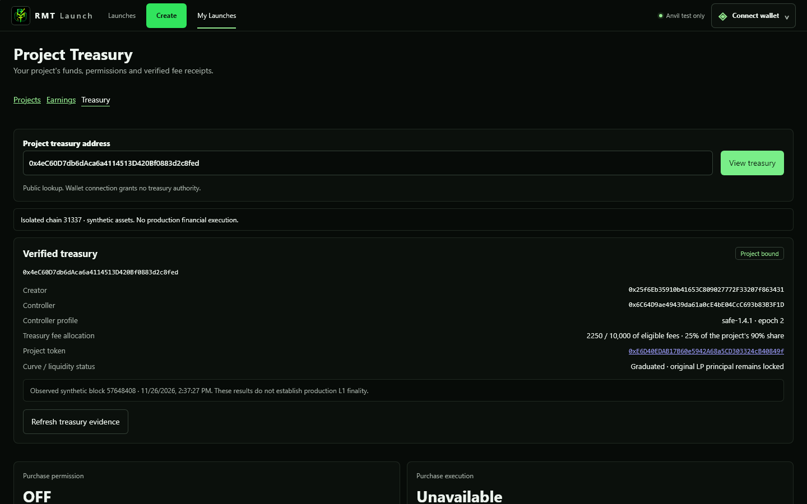

# Optional project treasury acceptance

Development candidate for [Task 076](https://github.com/LandoCrissian/robinhood-meme-terminal/pull/669#issuecomment-6989794878), stacked on Task 075 at `51e0ee874b635f1e104a40ff6419af3b5659fb90`. **BLOCKED_NO_BROADCAST.** This module is not deployed, production-enabled or independently audited. No production service, database, Firebase record, governance notice or royalty setting is changed.

## Product decisions

| Project and selection | Creation and earnings behavior |
| --- | --- |
| Standalone token, no treasury | Normal unchanged factory creation; zero treasury address and allocation. |
| Existing NFT community, no treasury | Same token creation. Collection metadata stays local; no collection calls or royalty changes. |
| Either, existing wallet beneficiary | Existing EOA/Safe beneficiary path and original fee ledgers remain available. |
| Either, optional contract treasury | Separate deterministic treasury deployment, then normal creator token creation with the exact verified beneficiary and intent. |
| Contract treasury with zero project share | Optional funding sidecar; core beneficiary and share stay zero. It gains no fee entitlement. |
| Before graduation | Treasury claims only its immutable original curve-ledger credit, including after V1→V2→V3 migration. |
| After graduation | Collection credits the original locked position's fee ledger; treasury claims its own native/token credits. Principal remains with the original engine. |

The existing factory does not deploy treasuries. A wrapper calling it would replace the creator's `msg.sender`; this implementation instead uses a recoverable two-step journey. Treasury deployment may precede token launch. Cancellation leaves that deployed treasury and its own funds intact; it cannot reserve another creator's intent or alter an existing beneficiary. A failed second transaction can be recovered/reviewed without redeploying the treasury. The creator pays additional synthetic deployment gas in the isolated fixture; no new platform creation fee is introduced.

The project chooses 0–100% of its **90% project share**. The existing denominator is preserved: 2,250/10,000 of eligible fees means 25% of the project's share. The core still fixes one billion tokens/18 decimals, 600M curve/400M liquidity, 0.0004 ETH creation fee, 2 ETH graduation backing, 1% curve fee, 90/5/5 eligible-fee distribution and 0.30% original pool fee. Treasury ownership cannot change these commitments, creator identity or holder balances.

## Implementation and trust

`packages/contracts/project-treasury` is an independent factory/treasury/interface package. Every existing tracked Solidity file and the core compiler configuration remain byte-for-byte unchanged. The full new closure has three source files and no external Solidity imports. `scripts/treasury/compiler.mjs` verifies the pinned 0.8.26 executable, compiler settings and complete source closure. Factory runtime/initcode are 1,881/26,100 bytes; treasury runtime/initcode are 22,705/23,377 bytes. Fixed constructor arguments remain within EIP-3860 and both runtimes within EIP-170. Core bootstrap size and identity are unaffected.

CREATE2 binds chain, factory, creator, persistent intent, controller, share, fixed creation template and pinned core dependencies. The factory accepts creation bytes only with its immutable compiled-template hash; the server supplies those bytes. One-use controller initialization is completed atomically by that factory. Exact materialization of all five treasury immutables is required before admission. No arbitrary code, delegatecall, spender approval, platform administrator or general upgrade entry point is available.

Supported controllers are an EOA, the pinned MetaMask delegation, or the pinned SafeL2 1.4.1 profile with three distinct EOA owners and two approvals, no modules/guard, and the reviewed fallback handler. Browser Safe controls produce an unsigned inner CALL; they do not impersonate an owner as the contract beneficiary or submit a Safe transaction. Actual 2-of-3 execution belongs to the isolated operator rehearsal. A Safe acting as the **creator of the treasury deployment** is not admitted by this fixture's direct-creator transaction verifier; Safe control of an EOA-created treasury is a separate supported profile.

The controller may propose replacement, with two days' public notice and incoming-controller acceptance. Rotation disables purchase intent and increments epochs. Queued withdrawals reserve an exact asset/amount/recipient, require the same epoch and two days' notice, and have bounded expiry; failed payment rolls back. Expired/stale reservations can be cleared without redirection. Maximums are eight token assets and sixteen pending withdrawals. Lost EOA control or Safe quorum has no RMT override. Beneficiary entitlements remain at the original treasury; a future contract cannot silently inherit them.

ETH and explicitly admitted, actually registered fixed-supply Token V2 ERC-20 assets are supported. Arbitrary ERC-20s, WETH/USDC, rebasing/taxed tokens and NFTs are not supported. Manual deposits, payer-declared royalties, unsolicited/reconciled transfers, curve receipts, LP receipts, held funds, reservations and withdrawals have separate counters. ERC-20 transfers do not require callbacks; exact balance deltas and runtime checks are mandatory. A funding label does not prove marketplace enforcement. Never send NFTs to this non-receiver.

## Purchase limitation

Purchase permission starts OFF. Its policy stores caps, minimum accumulation, cooldown, period, slippage/impact bounds and revocable epochs. Requests validate deadline, quote age/block, reservations, minimum output and nonzero route/reference commitments. Those fields do **not** establish independent market evidence. V1 has no admitted independent reference or executable route, so `purchaseExecutionAvailable()` is false and `executePurchase` always reverts. There are no purchase transactions, fabricated success events or automatic burns/distributions. Funds remain held and withdrawal/funding controls remain available when permission is disabled.

Local policy-review defaults are explicitly synthetic: 0.01 ETH per transaction, 0.02 ETH per 24-hour period, 0.001 ETH minimum, one-hour cooldown and 100 basis points each for stated slippage/impact. The controller reviews exact values before enabling intent. These are not approved production parameters or evidence of a working purchasing mechanism.

This is an intentional implementation gap permitted by Task 076's fail-closed boundary. Actual purchase execution requires a separately reviewed version with accepted price/manipulation defenses and canonical route evidence. V1 is immutable: do not deploy it expecting a later switch to enable swaps. Future fee entitlements cannot be moved by merely forwarding settled assets.

## Website and indexing

The existing `/create-token` form offers opt-out, existing beneficiary, or optional contract treasury; it preserves the draft, intent, separate review, rejection, missing-hash recovery and immutable creation fields. `/my-launches/treasury` displays actual accounting, original fee credits, controller/epoch, noticed requests and indexed events. NFT collection information remains local draft metadata; nothing is fetched, uploaded or redirected.

The existing fixture worker remains the only writer. Additional tables are admitted only in the named disposable loopback PostgreSQL fixture. Their records bind chain, both factories, canonical block hash, transaction and log identity; their inserts share the core checkpoint transaction, and reorg rollback cascades through the same checkpoints. Exact receipt logs must agree with provider logs, including topics and transaction membership. Authentication, bounded reads and existing settlement proofs are preserved. Production Railway schemas and writers are untouched.

Local support requires every existing chain-31337 manifest/origin gate plus `RMT_PROJECT_TREASURY_FIXTURE=local-reviewed-project-treasury-v1` and an absolute reviewed module manifest. Hosted flags, malformed manifests, wrong origins and missing bindings fail closed. Public reads report unavailable, financial POSTs return 404, and hosted startup rejects private fixture variables. The public build never asks for wallet access. Native claims or withdrawals without independent transfer evidence remain pending. Recovery never automatically signs or resubmits.

Fixture limits are explicit: treasury birth verification covers at most 4,096 blocks and 128 treasuries; reads return at most 100 events and 16 pending withdrawals. Recovery scans at most 256 blocks. The token-withdrawal UI verifier requires a single-transaction block to corroborate both historical balance deltas; broader block profiles remain unavailable. These are local acceptance limits, not production-scale indexing readiness. Production activation requires a separately accepted durable deployment/indexing configuration and canonical finality/trace policy.

## Observed verification

Both complete local browser journeys passed at source `378f3c0a88ff06020854ea156bbf6fed7b874f44`, including the readiness/form-value correction. Each engine recorded 48 receipt observations (40 successes and eight expected reverts), nine genuine Safe executions, four explicit form/dashboard submissions, three recoveries, two preserved creation archives and seven layout observations. Receipts include an intentionally orphaned claim used to prove reorg rollback; they are not all current canonical transactions after rollback. The separate standard desktop context read the actual indexed treasury with no injected wallet or wallet requests.

The sequence covers creator-only and two-step contract-treasury creation; exact 1B supply/zero opening backing; mined out-of-gas rollback with normal gas/nonce consumption; dashboard curve claims held pending during a native-proof outage; manual/declared/unsolicited funding; OFF/enable/disable intent without spending; original-ledger V1→V2→V3 continuity; Safe rotation and insufficient approvals; graduation and official v4-router buys/sells; LP collection and separate native/token claims; application/indexer restart; orphan removal/restored credits; and noticed token withdrawal with unchanged original LP principal. No treasury purchase transaction was executed.

These are **local chain-31337 executions on the existing pinned Base Sepolia 84532 fixture**, upstream block 57,648,300, hash `0x5bb29976ce80ddede79f192c61eba8fe9d96f499f8bfa11e0820d11820e91d20`, provenance commit `8dca5773cbd4dc98f52a45616f420bce96b000f0`. They are not new 4663 financial-fork tests, mainnet receipts or physical-device acceptance. The unchanged core compiler input is `437fb783d7dce558a05317e8b15877f6d08b9571bc12aefec360382469d53648`, matching Task 075; the complete new-module compiler input is `513609f57dea2fd706ac749999c47119955be16bb0b4f46a54b9fc4283683cf0`.

Local checks also passed: 224 website tests; 112 unchanged core and 23 treasury Foundry tests; four wrapper decoder and five receipt-observation tests; PostgreSQL 18.6 writer/conflict/rollback/restart/reorg checks; 110 release-evidence checks; 20 release-policy checks; 72 readiness checks; build/typecheck; repository dependency checks; and the production dependency audit. Final public Chromium/WebKit suites each checked desktop, portrait and landscape, including a deliberately dropped input event followed by exactly one real read-only request, blocked financial routes and zero wallet/external requests. The isolated Firebase profile browser suite passed all 12 profile mutations across both engines after capturing real response bodies promptly. No production profile data was used.

Two initial WebKit financial-page lookups produced no observable request before their timeout. The exact original trigger remains unproven. Twenty immediate public lookups did not reproduce it; the defensive readiness/form-value correction and subsequent full runs passed without retries or relaxed assertions. An older Linux graduation review returned only `unavailable`; its original catch omitted the underlying failure. The retained loopback route now exposes bounded, sanitized stages/error kinds and CI retains bounded fixture logs. These observations remain in the failure register rather than being described as independently cleared defects.

A later Linux default-lifecycle run observed a pending `null` sell receipt before the old helper dereferenced it. The helper now observes only that original hash, for at most 15 seconds/128 reads, then enforces hash/status/block/index membership. Malformed, reverted, conflicting or failed-provider evidence stops immediately. This is receipt observation, not transaction resubmission; five focused tests cover its boundaries. The original CI failure and initially skipped later stages remain recorded.

Chromium's `fullPage` capture changed touch/pointer emulation in a separately reproduced Playwright 1.55.1 probe. Treasury phone acceptance now uses viewport captures and asserts pointer/touch preservation; 44px interactive targets and 16px phone input requirements remain intact. The compact immutable supply display is measured separately. The temporary CSS workaround was reverted; the approved core styling is unchanged.

Raw [Chromium](evidence/rmt-task076/chromium-core.json) and [WebKit](evidence/rmt-task076/webkit-core.json) reports, [failure register](evidence/rmt-task076/original-failures.json), compiler/source manifests, public-read results and screenshots are retained under `docs/evidence/rmt-task076`. CI runs the default lifecycle, Task 075 profiles and Task 076 journey separately for both engines. Consult the draft PR's exact-head checks for final CI status; expected security failures remain real failures.

The [runtime source manifest](evidence/rmt-task076/runtime-source-manifest.json) binds 190 shipped website/indexer/common files to the source exercised by both journeys. The [artifact checksums](evidence/rmt-task076/files.sha256.json) retain raw report and screenshot identities. CI's default pull-request checkout may be GitHub's synthetic merge commit; its recorded checkout is distinct from the PR head whose checks it reports. A repository or build pass does not clear either contract analysis scope.

| Creator review | Verified treasury |
| --- | --- |
|  |  |



The secret scanner initially identified four public synthetic ERC-20 addresses and the pinned public token runtime hash as generic API keys in these raw reports. Their canonical receipt/runtime evidence was checked. Only those exact values in six named evidence files have narrow credential-scanner allowances; no credential pattern, source analysis detector or contract finding is exempted. The raw reports remain unchanged and the complete evidence scan passed.

## Reproduce

Use Node 22, pnpm 10.12.1, Foundry 1.7.1, checksum-pinned solc 0.8.26, PostgreSQL 18 and the installed pinned core dependencies.

```sh
pnpm install --frozen-lockfile
(cd packages/contracts && bash scripts/install-v4-deps.sh)
pnpm --filter indexer build
pnpm --filter @rmt/launch-website build
pnpm --filter @rmt/launch-website test:history
pnpm --filter indexer test:resilience
pnpm --filter indexer exec tsx --test src/curve-fixture-project-treasury-call.test.ts
forge test --root packages/contracts/project-treasury --use /absolute/path/to/solc-0.8.26 -vvv
node scripts/visual-qa/rmt-creator-integration.mjs --treasury-only \
  --browser chromium --anvil /absolute/path/to/anvil \
  --solc /absolute/path/to/solc-0.8.26 --pg-bin /absolute/path/to/postgresql/bin \
  --output /absolute/path/to/new-isolated-evidence
```

Repeat the final command with `--browser webkit` and a distinct output directory. It starts only disposable loopback processes, synthetic signers and a named isolated database; it never connects a production writer. Browser emulation is not physical iPhone acceptance. `.github/workflows/launch-website-review.yml` retains the original lifecycle and Task 075 profiles, then adds this treasury journey for both engines. The security workflow separately analyzes the complete new module without detector exclusions.

## Security and release holds

The existing **22 core/dependency high findings and two failed strict gates remain**. Fresh Slither 0.11.5 runs all 101 detectors on the new complete closure: 25 findings, including **six new highs**, four medium, ten low and five informational. The new strict module gate fails. Original seven-high and current six-high reports are retained separately; explicit byte concatenation removed one encoding observation while exact settlement assertions were retained. The six remaining balance observations have internal safeguards and test evidence, not independent clearance. See [each finding and remaining uncertainty](PROJECT_TREASURY_SECURITY.md). Passing lifecycle tests is not an audit or production authorization.

Separate prerequisites include review/disposition of those findings, independent price/route support before any purchasing version, contract deployment/runtime acceptance, controller/backup responsibilities, supported assets and withdrawal-policy acceptance, production discovery/trace/finality acceptance, and separate website/financial activation approvals. No approval is requested for completed local development.

## Unexecuted integration example

After a receiver is separately deployed and payment-tested, LAMMB Genesis could independently authorize royalties to its own dedicated treasury; that treasury could later buy its launched project token only after accepted liquidity/reference evidence and a reviewed purchasing version exist. Current Genesis royalties remain unchanged. Spending settled RMT creator revenue on LAMMB NFTs is a distinct future strategy requiring its own asset/payee/amount authorization; it is not enabled by a royalty deposit or purchase toggle. RMT Reclaim remains a separate unimplemented, manually funded module ($20 initial target and $0.05 per eligible NFT, later adjustable), not part of this treasury's purchase authority.

Specifically, a treasury bound to the future RMT launch could receive independently authorized LAMMB Genesis payments and later purchase that same RMT token. A treasury bound to a different project token cannot use this policy to buy RMT. The payment currency must be supported before any royalty recipient is changed; unsupported direct ERC-20/NFT transfers may be unrecoverable in V1.
