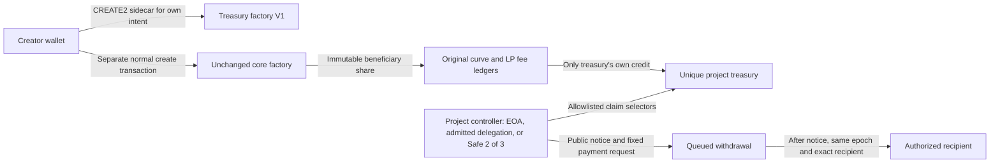

# Project treasury V1 security boundary

**Development only; BLOCKED_NO_BROADCAST.** This is an internal engineering
assessment, not an independent audit. The original launch-engine source,
economics, custody, deployment manifests and 22 retained high findings are
unchanged. The new package has its own complete compiler/static-analysis scope.
Its scanner result does not clear either existing release gate.

## Code and authority

The new reachable Solidity closure is exactly the three files under
`packages/contracts/project-treasury/src/`. It has no external Solidity imports,
proxy, upgrade entry point, RMT administrator, general-purpose call, delegatecall,
spender approval or NFT receiver. `foundry.toml` is isolated from the frozen core
compiler profile. Source/compiler/template hashes and actual size measurements
come from `scripts/treasury/compiler.mjs`; retain its exact output with the
acceptance package.

The Safe controller profile admits the pinned SafeL2 1.4.1 proxy and singleton,
three distinct EOA owners, threshold two, the pinned fallback handler, no modules
and no guard. Its own Safe transaction requires its normal approvals. The
delegated EOA profile admits only the already reviewed MetaMask designator and
delegate runtime. A wallet address is not a private key or proof of backup.

These checks admit a controller at initialization or rotation; they do not make
an external wallet's own signer set, threshold, modules or delegation immutable.
Those remain subject to that wallet's authority. The transaction-preparation
profile must recheck its supported current configuration. An indexed economic
receipt proves the actual treasury payment, not an independent assertion that a
Safe still has a particular approval policy. No wallet-policy change grants RMT
control of project funds or changes the core ledger's beneficiary address.

Initial controller validation occurs through a one-use initializer invoked by
the immutable deployment factory **inside the same CREATE2 transaction**. Every
controller action requires that initialization. A failed initializer rolls back
the deployment and intent registration. A third party cannot initialize it.
This avoids duplicate constructor/runtime checks that made the initial factory
exceed EIP-170; it creates no continuing factory administrator.

The factory accepts public treasury creation bytes only when their exact
Keccak-256 equals the immutable hash of the compiled V1 template. It bounds them
to 32,768 bytes, appends its own fixed ABI constructor arguments, and uses the
creator/intent/chain salt. It cannot deploy caller-chosen arbitrary code. The
server supplies the reviewed artifact, not user-provided bytecode. Prediction,
calldata, template, constructor arguments and canonical receipt must agree.

## Required invariants

- Only the creator can consume its factory intent. Another creator using the
  same intent has a different salt and treasury. Repeated or failed deployment
  cannot redirect an existing project.
- A separate normal core `create` call preserves its actual `msg.sender` creator.
  Binding requires `tokenForIntent`, original curve and ledger, exact token
  runtime, one billion tokens/18 decimals, creator-selected committed share,
  and the pinned factory/engine relationships. At zero share the core beneficiary
  must remain zero; the sidecar may still accept donations.
- The project's share uses the existing 0–9,000 denominator: 9,000 means 100% of
  the **project's 90%** allocation, not 100% of total fees. Supply, 600M/400M,
  1% curve fee and 90/5/5 distribution remain core-contract commitments.
- Curve claims retain the original ledger across engine migration. LP claims
  verify committed recipients, the engine/ledger binding and original position
  owner, approval and liquidity. The treasury never owns or withdraws that LP
  principal. Collection credits its fee ledger, not an arbitrary recipient.
- Every entry making an outgoing asset call is guarded. Native ingress only
  records the value actually received and makes no external call. Exact token deltas, received native
  credit counters, runtime checks and atomic rollback remain mandatory.
  Unknown/unavailable evidence is not a zero or a completed claim.
- ETH and token accounting are separate. Manual, **self-declared** royalty,
  unsolicited, curve-fee and LP-fee inflows remain distinct. An unsolicited
  transfer or sender-supplied source hash does not prove marketplace royalties.
- External ERC-20 admission is limited to actual registrations of the exact
  reviewed fixed-supply Token V2 runtime in the pinned core factory, including
  exact supply/decimals. A controller-supplied hash cannot admit a random
  fee-on-transfer, rebasing, proxy, callback or counterfeit token. WETH, USDC and
  arbitrary external tokens are unsupported in this V1. Direct supported-token
  transfers require balance-delta reconciliation. Direct unsupported ERC-20
  transfers cannot be prevented and have no rescue path in this version; do not
  send them here. NFTs are unsupported; unsafe forced NFT transfers may also be
  unrecoverable. Never change a collection's royalty recipient until its actual
  payment currency is supported, the receiver is deployed/verified and a payment
  test and that separate live recipient change have been authorized.
- Asset admission requires two days' notice and a bounded execution window.
  At most eight tokens can be admitted, with one slot reserved for the project
  token while unbound. Disabling deposits never disables authorized withdrawals.
- A withdrawal reserves a specific asset/amount/recipient. Two days' notice,
  bounded expiry, current controller epoch and unused request are required.
  Execution consumes state before payment; payout failure rolls everything
  back. At most sixteen withdrawals are pending and their IDs are enumerable.
  Anyone may clear expired/stale reservations; no keeper can redirect them.
- Controller replacement requires the current controller's proposal and the
  incoming controller's own acceptance after notice. Cancel/expiry is explicit.
  Rotation disables purchases, increments epochs and invalidates old queued
  authority without moving balances. Lost EOA control or lost Safe quorum has
  no RMT/deployer override; external backup and incident responsibilities remain.

## Purchase boundary and replacement limits

Purchases are OFF by default. A controller can record bounded settings and
disable them immediately. Validation checks amount/cap/reservations, policy
epoch, deadline, quote age/block, minimum output, stated slippage/impact and
nonzero route/reference commitments. **Those commitments are not independent
price evidence.** V1 has no admitted independent reference or executable route.
`executePurchase` therefore reverts `UnsupportedIndependentReference` after
validation, on every network; `purchaseExecutionAvailable` is false. There is no
purchase success event, fabricated history, swap, hidden router or spend path.
Purchase-history fields are explicitly zero because this version cannot buy.

A production execution implementation requires a separately reviewed version,
real route/reference acceptance and separate authorization. V1 is not generally
upgradeable. A future treasury cannot silently replace an immutable original
ledger beneficiary. A controller can separately queue transfers of its settled
treasury assets, but original future fee credits continue belonging to the
original treasury. Do not describe forwarding assets as migrating those rights.

## New static-analysis findings

Slither 0.11.5/Crytic Compile 0.3.11 runs all 101 detectors over the complete new
reachable closure. The initial hash-bound factory report contained seven highs:
one packed-encoding observation and six balance-read observations. No detector,
severity, source exclusion, suppression or exact balance assertion was removed.

The fresh explicit-concatenation closure, input SHA-256
`513609f57dea2fd706ac749999c47119955be16bb0b4f46a54b9fc4283683cf0`,
reports **25 findings, including six highs**, with all 101 detectors enabled.
The six balance-finding IDs are unchanged; the encoding detector no longer
reports a finding. Both raw reports are retained. The strict new-package gate
still fails. Its measured runtime/initcode sizes are **1,881/26,100 bytes** for
the factory and **22,705/23,377 bytes** for the treasury. Including fixed ABI
constructor arguments gives 26,260 factory-init bytes and 23,665 child-init
bytes, below EIP-3860's 49,152; each runtime is below EIP-170's 24,576.

| Finding | Boundary and existing protections | Disposition and uncertainty |
| --- | --- | --- |
| `encode-packed-collision`, factory `_initCode`, initial report | The prefix is an exact immutable-hash-bound creation template; the suffix is fixed-length ABI arguments. | No ambiguous variable prefix was demonstrated. Explicit `bytes.concat` states byte concatenation; a 512-input equivalence fuzz test and CREATE2 deployment fuzz preserve exact init bytes. The fresh unchanged detector no longer reports this observation. |
| `reentrancy-balance`, `_depositToken`, `beforeBalance` | Guarded entry; exact registered Token V2 runtime; only caller's `transferFrom`; exact treasury delta. | Internally assessed conservative under these pins. Keep the assertion. Runtime/admission correctness and future source changes need review. |
| Same function, `senderBefore` | Same boundary; exact caller delta also rejects unexpected transfer behavior. | Same retained uncertainty; not a general claim that arbitrary ERC-20s are safe. |
| `reentrancy-balance`, `executeWithdrawal`, `beforeTreasury` | Current-epoch matured fixed request; reservation/credit consumed before call; guard; registered standard token; exact outgoing delta. | Internally assessed conservative. Native callback/rejected-payout and token conservation tests support the controls; no independent clearance. |
| Same function, `beforeRecipient` | Recipient is fixed by the queued controller-authorized request; exact recipient delta is preserved. | Same retained uncertainty. No recipient-controlled token callback exists in the admitted implementation. |
| `reentrancy-balance`, `claimLp`, `beforeToken`, combined `claim` | Pinned ledger/engine/policy and custody; guard; known token; native receive only records inflow; exact return/credit/token checks. | Internally assessed conservative. A mismatch reverts the entire ledger claim and preserves entitlements. Do not remove settlement checks. |
| Same function, `claimAsset` | Same boundary with native-only/token-only scope and exact deltas. | Same retained uncertainty. Separate claims and interrupted execution are tested; future ledger/token implementations require fresh review. |

No concrete fund-loss path was confirmed in this internal review. That is not a
proof of absence. The six balance observations remain unresolved review items
and the strict new-package gate remains blocked when those highs are reported.
The original 22 highs and two failed core static-analysis gates remain separate.

## Test scope and limits

The new Foundry suite covers deterministic address/intent separation, wrong
template/oversized bytes, failed initializer rollback, direct initializer
authorization, zero share, wrong binding/chain/controller, funding classes,
original ledger claims, separate LP assets, custody mismatch, malformed/unknown
asset rejection, admission notice/limits, controller notice/expiry, stale
reservations, rejected payouts, callback reentry, disabled purchases and bounded
requests. Fuzzing covers CREATE2/intent identity, exact concatenation and native
conservation at 512 inputs each. The observed run passed **23 tests**: 22
unit/fuzz tests and one stateful invariant. The invariant runs 128 sequences of 32 handler calls,
including expected rejected operations, checking held assets, reserved amounts,
withdrawn totals and bounded queues. These local tests use synthetic identities
and mocks; the separate same-app lifecycle uses actual frozen core contracts,
synthetic Safe signatures, migrations and official v4 fixtures.

Passing tests and source verification are not audit clearance. Actual manifests,
raw scanner output, local receipts and CI results must accompany release review.
Physical-wallet treasury acceptance, production indexing/schema rollout,
independent L1 finality/provider acceptance and all owner deployment/financial
approvals remain separate. No live royalty settings, wallets, services, token
economics or funds were changed by this package.
