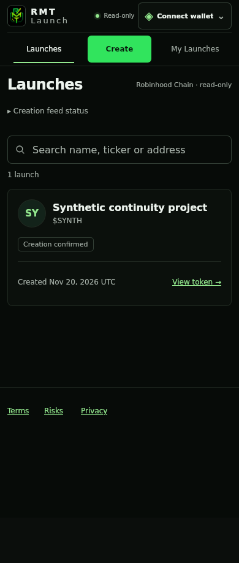
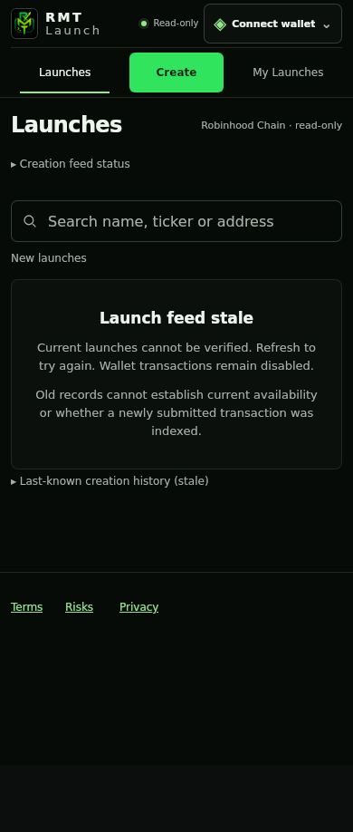

# Authenticated discovery continuity acceptance — Task 088 A

Status: isolated repair; production application remains unapproved. **BLOCKED_NO_BROADCAST.**

Authorization: [revised Task 088](https://github.com/LandoCrissian/robinhood-meme-terminal/pull/681#issuecomment-7031268807). Base: Task 087 PR #681, exact head `62548d68cbdba8b206965fbbd238261a0b1d2af7`. This PR is stacked on that branch. Website reliability is the immediate workstream; contract review remains separate.

## Production evidence and the exact limitation

The existing Netlify site is still serving deploy `6afd4265956a469adeb55747`, whose title identifies the Task 071 / PR #666 artifact. Provider metadata has no full source commit binding. At the bounded November 20 inspection, its historical API returned `verified-snapshot / stale`, checkpoint `113899119` dated November 14. The new-engine route returned 404/unavailable.

The existing Railway worker deployment `b48f0e6e-a34b-4a26-b95f-d4b978562282` remained successful. Its health observation reported historical indexed block `118811376` and latest `118811396`, while new-engine discovery had a ready checkpoint `118811400`. These are different observations, not one atomic chain snapshot. The worker cursor does not prove that a Netlify request authenticated or delivered that data.

The historical reader selects the committed snapshot whenever the server URL/credential is missing or invalid, the authenticated request fails, the body/schema fails, or the snapshot merge rejects evidence. The deployed artifact does not report those reasons. Its stale historical snapshot is also explicitly permitted 15 seconds of durable edge caching. The observed cache header included `Netlify Durable; fwd=stale; ttl=-4869; stored`; that header alone cannot identify the origin failure.

**The precise live fallback trigger is still unverified.** The continuation used provider request detail plus the owner's ordinary authenticated Netlify CLI session. The correlated function invocation emitted two info entries but no categorized fallback reason; a fresh site-variable listing decoded to an empty array, and current legacy build settings contained no named read bindings. These current site listings do not prove the deployed function-version environment. The bounded Railway HTTP query contained the independent health read but no historical launch request. Missing/obsolete origin or credential configuration, wrong credentials, transport failure and schema/merge rejection remain distinct possibilities. No credential values were exposed or used. A deployment title, invocation duration or advancing health endpoint cannot establish the missing reason. This supersedes the initial assumption that connector log capability alone was the blocker; see the [continuation observation](evidence/rmt-task088/completion/production-observation.json).

See [production inspection](evidence/rmt-task088/production-inspection.json) and [inspection notes](evidence/rmt-task088/production-inspection-notes.txt). The continuation independently reproduced and repaired the historical strict-newer lifecycle merge defect: the indexer supplies an actual transition receipt while the snapshot records a later lifecycle observation. An already-reflected receipt can be earlier or at the same block; it is now accepted only with consistent state, hashes, timestamps and unchanged exact creation identity. Contradictions and graduation reversal remain rejected. Available production evidence still does not prove that this merge defect caused the live fallback.

## Proven source defects and repair

1. `productionDirectory()` converted every stale new-engine feed into a ready directory. The base-source regression returns actual `ready` against expected `stale`. Stale data now becomes a separate history state, with no current cards, lifecycle claim or empty-current-inventory message. History remains collapsed and explicitly dated/stale.
2. Indexer discovery and earnings sampled status before awaiting PostgreSQL, then could return that ready status after freshness expired. The original regression reproduces that race. Both now sample status again after the read, preserving revision/unavailable checks and exact receipt identities.
3. New-engine HTTP stale responses previously returned 200 for existing rows. They now return 503 with no-store. The handler rechecks age after the awaited read; exact absence is 404 only at a current verified checkpoint. Historical stale snapshots no longer receive durable-cache permission, and stale exact absence is 503.
4. A mounted directory could retain current cards indefinitely. Its server-derived two-minute deadline now expires current cards into stale history; visibility changes recheck the deadline, and a subsequent clock rollback cannot promote already expired cards.
5. Fixed, bounded server diagnostics now distinguish configuration, authentication/HTTP, network, body, schema and stale outcomes for new-engine reads. Historical reads distinguish configuration, transport, HTTP, body, schema and merge failures on Netlify as well as Railway. Diagnostics do not include headers, credentials, upstream URLs, exception text or response bodies.

Authentication, exact chain/deployment/receipt validation, private-origin bindings, forwarded-authority guards, response size limits and redirect rejection remain enforced. No database schema, package lock, contract, production configuration or financial activation flag changes.

## Completion follow-up

The final follow-up closes three additional reproduced source gaps without changing authentication, contracts, dependencies or deployment settings:

- Decimal block identities now require strings. A numeric/string mismatch can no longer skip same-height hash binding. Same-height timestamps bind to the same instant while accepting equivalent ISO spellings.
- Cached historical evidence and awaited HTTP results recheck both age and future-clock skew. A clock rollback cannot leave a future-invalid checkpoint ready or turn uncertain absence into a cacheable 404.
- Historical lifecycle merge uses receipt/observation continuity, preserving exact creation identity and one-way graduation.

Seven before-fix failures are retained from a 49-test focused run. Candidate Node 22 regression results are **324 passed, zero failed/skipped**; the expanded actual TLS/PG/Next harness passed **21 HTTP checks and 30 Chromium/WebKit cases**, including numeric-height rejection. Typechecks, Knip, PostgreSQL smoke, actual offline Netlify server/edge build and artifact preflight passed. See [current commands/source digests](evidence/rmt-task088/completion/test-results.json), [browser report](evidence/rmt-task088/completion/continuity.json) and [fresh read-only production evidence](evidence/rmt-task088/completion/production-observation.json).

The two Gitleaks matches are now covered by a separate immutable public-source checksum proof, following the existing repository mechanism. All four original tests and the original five-record policy/verifier remain unchanged. **52 tests passed**, including source/blob/line/value/future-fingerprint tampering and unknown/missing/duplicate observations. The actual unchanged full-history scanner still exits **1**, retains the same seven matches, and detects the unrelated random canary. Exact public-data adjudication classifies seven matches with zero unknowns; the wrapper exits 0 and still rejects the canary. No scanner rule, ignore, severity or raw finding is removed. No contract/financial clearance follows. [Proof, raw before/after and adversarial evidence](evidence/rmt-task088/hash-adjudication/README.md).

## Isolated verification

The reproduction uses synthetic credentials, an expendable loopback PostgreSQL **18.6** cluster, the actual PostgreSQL store and bearer verifier, a synthetic HTTPS Railway-shaped backend with its own trusted local certificate, and the real optimized Next application. A loopback test proxy supplies the existing admitted host/protocol shape. No public preview was deployed, no production credential was copied, and no chain transaction was submitted.

- Website regressions: **315 passed, zero failed/skipped**, Node 22.16.0. Includes existing creation/claim receipt recovery, wallet rejection, missing hash, reorg, failed/reverted transaction and no-repeat-signature checks. These are synthetic tests, not a live creation-journey acceptance.
- Indexer typecheck, build and resilience smoke passed. The new before-fix race failure and candidate success are retained separately.
- PostgreSQL adapter, earnings (53 registrations) and production-shaped claim smoke passed: atomic interruption, lease conflict, duplicate replay, monotonic cursor, stale checkpoint rejection, writer reopen, bounded rollback and exact replacement receipt.
- A real clean restart of the isolated PostgreSQL process preserved byte-identical ordered bindings/checkpoints/launches. This proves clean restart persistence, not crash durability or production backup recovery.
- Website/indexer typechecks passed. Eight website/Railway source preflight tests and four Python packaging tests passed. Knip passed with two unchanged redundant-entry hints.
- Authenticated continuity: **19 HTTP checks and 26 Chromium/WebKit cases** passed, desktop and portrait; includes mounted expiration and sticky stale after clock rollback. Zero external browser requests or wallet requests. The existing polish suite passed all **8** Chromium/WebKit desktop, phone portrait/landscape and narrow layouts. Four selected screenshots are retained below.
- The actual offline **Netlify Linux server and edge build passed**, using CLI 27.14.2, adapter 5.16.8 and ARM Deno 2.4.2. Artifact preflight verified native modules, routes, archives, both native rate rules and no synthetic credential marker in static assets. Initial pnpm and wrong-architecture Deno failures are retained. No deployment occurred.
- Local tests/builds ran at base HEAD plus the application diff bound in `test-results.json`; the preflight sourceCommit names that base. Exact candidate SHA and CI are independently recorded in the PR description. Initial tool/harness failures are retained rather than claimed as passes.

See [evidence directory](evidence/rmt-task088). Source hashes and exact command outcomes bind the final recorded test run; screenshots are synthetic and CI artifacts are not live production evidence.

### Synthetic visual evidence

Fresh creation evidence and the expired page are independent test states. Neither image claims a live registration.

## CI follow-up

The first published candidate `3ec076fdd77e6dd502061040698c998eadc81b7b` passed repository/indexer, actual Netlify packaging, Railway container and all 112 core Foundry tests. Its new browser dependency install stalled; the workflow now uses the same signed HTTPS Ubuntu archive preparation as the existing browser jobs. No application source changed in this follow-up.

The initial unchanged full-history Gitleaks gate reported two new unclassified matches at `test-results.json:14-15`: the recorded SHA-256 digests of `launch-api.test.ts` and `launch-api.ts`. All 16 source digests were recomputed and match. These are public file digests, not credential values. The raw failure remains retained in CI. The completion follow-up adds only the exact immutable public-source proof described above; scanner rules, ignores, raw-exit handling and financial gates are unchanged. Original [redacted artifact](https://github.com/LandoCrissian/robinhood-meme-terminal/actions/runs/44682350976/artifacts/14604263838).

## Production application proposal and recovery

No production application is authorized by this PR. Preserve the original Railway writer, PostgreSQL volume and backups.

A separate owner-approved website-only application must bind this exact tested source/artifact, preserve the existing server-only credential references and origin, obtain runtime nonsecret diagnostic categories, and verify an authenticated fresh response through the actual Netlify server. The read-only discovery profile and financial creation/trading/claims approvals are independent. If configuration requires changing, present the exact nonsecret setting names, scopes and intended values separately; credential values stay private.

After an approved application, require current checkpoint age, exact deployment/chain/receipt identities, correct stale/outage behavior, 404 public financial gates and zero background wallet requests. If acceptance fails, keep discovery unavailable/stale and financial routes closed. Fix forward through a separately reviewed website artifact/config correction. Never mutate or restore the production database merely to make a feed appear current; any database restore requires its own authorization and recovery evidence.

Historical Task 066 evidence records an encrypted owner-local PostgreSQL backup and isolated restore. It explicitly leaves an off-device recovery copy unverified. This task did not access, copy, restore or rotate the production backup and does not certify its current recoverability. Fresh encrypted backup verification, off-device copy and any restore are separate scoped owner decisions. Current Railway credits/allowance are not asserted.

## Separate security and governance status

The source-only check of the separate core register matched all 22 retained High finding IDs, the raw compressed scanner digest and 21 source/evidence digests. The existing internal dispositions are not new clearance. No new Slither or Foundry reproduction was performed in workstream A; no contract patch or scanner weakening is included. The all-101-detector strict result remains failed, with seven governance Medium observations preserved separately.

The five checks exposed for exact base PR #681 (repository, indexer, contracts, operations-safe and Gitleaks) passed. That does not rerun or clear the six strict security failures retained on the earlier base. Candidate checks and their exact SHA are separate evidence.

Governance was not reobserved as part of this website-only repair. Task 087's last verified status was pending; permissionless execution risk must not be assumed gone. The previously recorded inclusive deadline is November 26, 2026, 19:50:06 UTC (12:50:06 PM MST). No signing, execution, cancellation, broadcasting, financial activation or RMT creation occurred. Fresh governance verification and any subsequent owner decision remain separate.
