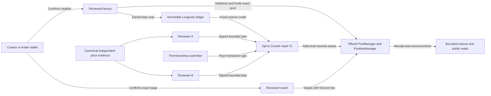

# RMT Launch release candidate

The frozen core source is commit `69cfaa392e488f475b8b1e15a34c0ac986abd24e` in draft PR #580, with Git tree `e15e0450680bf9f0f8261213ca5aa5a9c95438dd`. The validation target runs on loopback chain 31337. This handoff records the audit inputs and separate release decisions for core and Growth Vault. [Exact-head checks](https://github.com/LandoCrissian/robinhood-meme-terminal/pull/580/checks)

## Review stack

| Scope | Review head | Base branch or relationship |
| --- | --- | --- |
| Main preservation baseline | `6d0b8103bdad95367445a38e5f5327458baa9ab2` | `main` |
| Scope reset #576 | `f563870d9933b7cfa2035cdeaa138a5785da244d` | Separate draft targeting `main`. The stacked scope commit is `d5a885e93580e6df25c42d6aa53672962e125888`. |
| Launchpad V4 base | `ae504c8a6851a96d3a0bda9861551e8ec1d04385` | `rmt-launch-v4`, descends from main |
| Isolated preview #577 | `65f03800df993a1dbc9f1de9f612d83233b8404d` | `rmt-launch-v4` |
| Guard and Longevity #578 | `f17e2eb3a014976d7adeab78e54ea63191850693` | `rmt-launch-v4-preview` |
| Growth Vault #579 | `50ac0c62e39ce11332025f774d164d72c155b878` | `rmt-launch-longevity-v1` |
| Hardened launchpad #580 | `69cfaa392e488f475b8b1e15a34c0ac986abd24e` | `rmt-launch-liquidity-growth-v1` |
| Audit handoff #580 | `02936ff3e914390dbd240bfde9ad66717525cdab` | Parent of the cleanup stack |
| Cleanup #582 verification baseline | `c2b96033a036f020ac1fd16f93752730a5fdcb30` | `rmt-launch-release-candidate` |

The cleanup baseline passed all 14 reported checks, including 535 Foundry passes with the four default skips listed below. All tracked Solidity still matches the freeze and the contract source tree remains `f0d132e63fcba8d2e354f5abe5a72ad46ac3dc0b`. [Cleanup baseline checks](https://github.com/LandoCrissian/robinhood-meme-terminal/actions/runs/43309047238)

### Legacy integrations excluded

The CannaCat drafts #575 and #581 are closed and excluded. #582 removes the curated entry, artwork, project metadata and dedicated release dependency. The remaining synthetic security fixtures use a fictitious token and hooked pool. The launchpad browser checks that all four former embed POST endpoints return 404. Generic authorization, wallet binding, verified settlement and transaction recovery tests remain active. The frozen historical Terminal V4 fork is a manual replay, with its own evidence. LAMMB Empires remains independent.

### Final source manifest

The frozen Git tree covers the full tracked source and transitive workspace files. Use the following selectors to focus the independent review.

| Review input | Frozen paths |
| --- | --- |
| Core contracts | `packages/contracts/src/RMTV4LaunchDeploymentV2.sol`, `RMTV4InitializationGuard.sol`, `RMTV4LaunchFactoryV2.sol`, `RMTV4LongevityLedger.sol` and `RMTV4LaunchFactoryV1.sol` under the same directory. V1 supplies the fixed-supply ERC-20 and compatibility engine. |
| Build and provenance | `packages/contracts/foundry.toml`, `remappings.txt`, `scripts/install-v4-deps.sh`, `scripts/deploy-launchpad-local.mjs` and `test/fixtures/rmt-v4-deployment-identities.json` under `packages/contracts`. The lockfile blob is `4c488ab6dd1ea3bdf0c11fbac96e3b4ae80a530a`. |
| Wallet and UI | `apps/web/app/(launchpad)` tree `393568a48f2a8200fce79a13ec8ab29cf3b7de11` and `apps/web/lib/launchpad` tree `ca344d85ad04bda7a36f4b25c7bbf3973c9e8212`. Include the journal, original-router recovery and exact sell trace. |
| Public reads and evidence | `apps/web/app/api/launchpad` tree `5929be679b72311bfa49191b7a75b48ade8bfa9e`, `apps/web/app/mcp` tree `62d9dc45e7b07b541ee3d63116daca9c2ba52928`, `apps/web/lib/server/new-launchpad-*.ts`, `apps/web/scripts/new-launchpad-indexer.ts`, web middleware and runtime config. The five operations are `list_launches`, `get_launch`, `get_launch_checks`, `get_pool_state` and `get_launch_activity`. |
| Core verification | `packages/contracts/test/RMTV4LaunchFactoryV*.t.sol`, `RMTV4LaunchFactoryV*Fork.t.sol`, `RMTV4LongevityLedger.t.sol`, `apps/web/lib/launchpad/*.test.ts`, `new-launchpad-*.test.ts` under `apps/web/lib/server`, `scripts/visual-qa/rmt-launchpad-browser.mjs` and `scripts/verify-guarded-v4-interoperability.mjs`. |
| Optional Growth scope | `packages/contracts/src/RMTV4GrowthVaultV1.sol` blob `a39b5a0396629ee5a059cc105a6ed20e651223e7`, its deployer, tests and fixture, and growth price, config and health modules. Keep fixture-only opt-in and review any future Growth activation separately. |

Use these commands from the repository root to reproduce the exact manifest, inherited diff and protected overlap evidence.

```sh
candidate=69cfaa392e488f475b8b1e15a34c0ac986abd24e
main=6d0b8103bdad95367445a38e5f5327458baa9ab2
git rev-parse "$candidate^{tree}"
git ls-tree -r --full-tree "$candidate"
git diff --name-status "$main" "$candidate"
```

## Authority and threats



| Threat | Invariant and review evidence |
| --- | --- |
| Front-running pool initialization | The guarded key uses only `BEFORE_INITIALIZE`. Only the factory bound to that manager and guard may initialize. A hookless key is a different pool. Review factory deployment atomicity and full-key identity through quotes, receipts and indexing. |
| Wrong chain, recipient, or duplicate wallet submission | Bind each action and recovery to the exact chain, account, calldata, value, pool, and router version. Preserve explicit confirmation, simulation, bounded approvals, deadline, reviewed minimum output and strict settlement. The 2.1.2 path includes a positive per-hop floor. |
| Reorg or mixed RPC data | Verify requested block number and hash. Publish only exact factory receipts and funded custody. Verify the index checkpoint and any provisional launch blocks on public pages, and recheck each detail launch before returning current evidence. |
| Accounting drift, reentrancy or failed increase | Credits reconcile to immutable entitlements and actual payouts. Growth accounting satisfies collected plus harvested equals held plus added separately for both assets. A failed increase rolls back fee harvest, funding and approvals. The nonce advances only on a successful add. |
| Principal withdrawal or reserve redirection | The original position remains factory held. The growth position stays vault held. Growth harvest uses a zero-liquidity decrease and checks custody and liquidity. No mutable owner action, arbitrary call, withdrawal or redirect is exposed. |
| Unavailable or dishonest reference | Confirm source identity, market separation, canonical block, time, liquidity, observation history and agreement. Treat a second RPC reading the same pool as the same market. Missing evidence keeps Growth unavailable and ordinary launches independent. |

## Reviewer operations and recovery

The loopback fixture uses two disposable Anvil accounts. Production operators have yet to be appointed. For a production proposal, identify the two operators and separate their key custody, infrastructure access, evidence gathering and incident escalation. Each must independently inspect the source and proposed caps and refuse to sign if the source cannot be corroborated. A production proposer should publish the reviewed digest, observation and expiration without publishing signing secrets. A submitter pays their own network costs. The vault provides no fee reimbursement or automatic execution.

One key cannot produce a valid plan. Two colluding reviewers can authorize a misleading reference within the contract's execution bounds. The vault enforces caps, deadline, nonce and proximity to spot. The reference's quality depends on the independent validation and reviewers. Restrict operations to one executable digest per nonce. If competing signatures escape, any caller can submit either until one succeeds or they expire. A deferral keeps the nonce available. Reconcile receipt outcome, expiry and current nonce before reissuing.

| Future design | Trust and availability |
| --- | --- |
| Keep immutable 2-of-2 | Smallest authority surface. Lost access to either key can leave reserves held indefinitely. |
| Threshold-signed cancellation | Can invalidate a leaked plan only if cancellation lands first. It requires both original signers and does not restore a lost key. |
| Immutable 2-of-3 | Can continue with one key unavailable. Any two operators can jointly approve a bad plan. |
| Delayed threshold rotation | Can recover reviewer operations if a separately governed recovery threshold survives. It creates a new replacement authority and delay policy to audit. |

Each change to signer authority needs a separately reviewed version and owner decision. A replacement vault cannot recover V1 reserves because the reserve recipient on the original launch is immutable.

## Provenance and production build delta

The local fork is anchored to Base Sepolia block 57648300 and its recorded hash. Verify the manager, position manager, StateView, Quoter, Permit2, router and guard bindings and runtime hashes against the checked-in pins. The router 2.1.2 Base Sepolia address is `0x8702463e73f74d0b6765aBceb314Ef07aCb92650`. The local V2 runtime can select it explicitly. Router 2.0 remains the default compatibility path. [Deployment fixture](../packages/contracts/test/fixtures/rmt-v4-deployment-identities.json), [official deployments](https://developers.uniswap.org/docs/protocols/v4/deployments#base-sepolia-84532), [official API support](https://developers.uniswap.org/docs/trading/swapping-api/supported-chains)

Robinhood Chain 4663 is the review target. The [isolated compile](RMT_ROBINHOOD_4663_PROVENANCE.md#offline-review-build) compares a 4663 bytecode template with a 31337 template from the frozen sources under identical compiler settings. The two source changes are applied only inside compiler input. The deployer constructor and V2 factory gate change, with the latter inherited from the ledger. The frozen 31337 Foundry and browser evidence remains separate. Review and approval of exact production constructor inputs, deployment provenance and the full launch runtime remain outstanding.

| Layer | Target-chain review input still needed |
| --- | --- |
| Deployment and bytecode | `RMTV4LaunchDeploymentV2`, `RMTV4LaunchFactoryV2` and the V2 use of `RMTV4LongevityLedger` enforce chain 31337 at deployment, launch, collection or withdrawal. A separately reviewed production V2 build must bind these gates consistently to the approved chain. Preserve V1 compatibility. Provide compiler and dependency inputs, creation and runtime hashes, constructor values and immutable bindings for the new build. |
| Guard provenance | Provide target-chain PoolManager, PositionManager, Permit2, Quoter, StateView and router addresses, runtime hashes and reciprocal bindings. Review the one-shot deployer's nonce, CREATE2 salt, expected guard and factory addresses and the guard's `BEFORE_INITIALIZE` bits. Verify the actual deployment transaction, block and code before activation. Keep the Anvil-only bootstrap as test tooling and use a separately reviewed production deployment procedure. |
| Runtime and wallet | `new-launchpad-config.ts` admits a loopback 31337 RPC and rejects Vercel. `launch-record.ts`, `launch-wallet.tsx`, `direct-v4.ts` and `router-pins.ts` bind the current chain and Base Sepolia router profile. Add a reviewed target-chain profile, capability and activation gates, approved wallet and RPC transport, and exact native settlement trace support. Re-test quote, approval, confirmation, recovery and receipt binding on that build. |
| Index and public data | The local index uses SQLite, a zero-confirmation cursor and `local_chain_observed` evidence. Provide reviewed production finality, durable index/storage, replay and reorg recovery, historical RPC and quota arrangements. Keep the loopback MCP origin policy or separately review any authorized hosted transport. Hosted routing and indexing remain unknown for the eventual exact chain, manager and PoolKey. |
| Economic consistency | If approved terms differ, align the factory and ledger constants with calldata, UI review, exact receipt acceptance and public evidence. Include those changes and tests in the new audit input. Keep Growth Vault fixture gates and protected legacy execution out of the core activation path. |

## Core economics decision sheet

All values below are current **unapproved draft terms** for the guarded V2 engine.

| Decision | Draft value and consequence |
| --- | --- |
| Supply and allocations | 1 million, 100 million or 1 billion fixed ERC-20 tokens at 18 decimals. The creator selects a 10–100% pool allocation. The position receives the actual rounded token deposit and the creator receives the remaining supply. The local form prefills 1 million and 80%. |
| Funding and minimum liquidity | Native ETH is the quote asset. The requested seed range is 0.001–100 test ETH, with 0.1 ETH prefilled locally. The factory requires positive actual ETH and token deposits and positive v4 liquidity, then refunds unused ETH. The requested seed floor is distinct from actual deposited ETH and supplies no separate dollar-depth or liquidity-unit floor. Initial price follows the selected two-sided amounts. |
| Pool and platform fees | Full-range position with spacing 60 and ticks −887220 to +887220. The pool's static LP fee is 3000 hundredths of a basis point, or 0.30%. The draft charges zero separate RMT creation and swap fees. Verify the target PoolManager's protocol fee state for the approved profile. |
| Recipient rights | The ordinary V2 policy assigns 100% of earned fees from its original position to the creator. Longevity is off by default. Opt-in fixes the creator, treasury and reserve shares to a total of 10,000 bps with distinct recipients for positive shares and a positive treasury or reserve share. Anyone can trigger V2 collection. Each committed recipient alone can withdraw their own credited ETH and tokens. Fractional dust carries forward. |
| Principal custody | The factory permanently holds the original PositionManager NFT. Fee collection uses a zero-liquidity decrease and verifies ownership and unchanged liquidity. Recipients have fee rights only. |

[Factory terms](../packages/contracts/src/RMTV4LaunchFactoryV2.sol), [ledger rights](../packages/contracts/src/RMTV4LongevityLedger.sol), [launch review defaults](../apps/web/app/%28launchpad%29/_components/create-launch.tsx)

### Separate Growth economics

A growth add needs positive tracked reserves of both assets, with up to 100 ETH and 1 billion tokens per plan, plus a positive minimum liquidity output. A plan may bound square-root price deviation by up to 50 bps. This corresponds to an actual price change of about +1.0025% or −0.9975% at the extremes. [Vault accounting](RMT_V4_GROWTH_VAULT.md)

Recorded reserve credits and held balances are distinct from completed adds. Zero activity, one-sided accrual, dust, sustained price movement and higher execution costs can result in no add for an indefinite period. In the tiny-reserve simulation, tracked assets were worth 1,797,299 native wei at the synthetic reference. The add used 434,763 gas measured inside the Foundry call frame. At a hypothetical 20 gwei this is 0.00869526 ETH. The estimate excludes intrinsic gas, deployment, fee collection, L1 data and operator costs. It establishes neither a live cost nor an economically viable add.

The [price validator](../apps/web/lib/server/growth-price-evidence.ts) takes two approved venues with distinct operators and authorities on the target chain. Each adapter must provide a time-weighted observation and the minimum executable two-sided depth within 1% over its window. Draft checks require a 30–120 minute window, at least 12 observations and 5 quote ETH of depth, an observation no older than 120 seconds with at least two confirmations, and at most 30 seconds of source skew. The validator binds block numbers, hashes and timestamps, checks source runtime identities and rejects disagreement above 50 actual-price bps or target spot deviation above 100 actual-price bps. Spot can veto a reference. The reference comes from the corroborated source observations. No approved live registry, adapter or production reviewer operation is configured. The explicit loopback fixture uses a canonical opening observation for at most 120 seconds.

## Independent review coverage

Review the guarded V2 lifecycle from one-shot deployment to collection and withdrawal. The exact owner-approved production build will need its own review inputs.

| Core review boundary | Evidence and open questions |
| --- | --- |
| Atomic deployment and initialization | Verify predicted factory and guard addresses, constructor bindings and permission bits. Exercise an unauthorized initialization attempt and a failed launch followed by retry. Verify hookless and alternate keys cannot interfere with the guarded key. |
| Token creation and funding | Inspect fixed supply, allocation and mint, exact temporary ERC-20 and Permit2 allowances, PositionManager settlement, actual PoolManager balance changes, native refund, and all rollback effects. Verify both assets and NFT custody before exposing a launch. Review forced balance changes and refund callbacks. |
| Trading and recovery | Follow the full chain-qualified key through the quote, reviewed calldata, wallet chain/account, spender, receipt block and exact settlement trace. Exercise 2.0 journal recovery after a router change, 2.1.2 per-hop bounds and reorg or provider interruption through the five read surfaces. |
| Custody and accounting | Verify zero-principal decrease, unchanged NFT owner/liquidity, immutable recipient rights, cumulative rounding dust, recipient failure and reentrancy. Review interleaved launches and ensure fee withdrawal can only debit the correct bucket. |

Slither 0.11.5 passed its configured high-severity gate on #580. Full CI could not generate SlithIR for V1 `_fundPosition` at lines 240–266. A preserved scoped analysis of the inherited V2 helper also failed IR generation on the `deadline.toUint48()` call in its Permit2 approval. V2's helper is at lines 257–283 in the frozen source. These gaps cover both allowance lifecycles, PositionManager mint and settlement, exact balance checks and NFT custody. The V1 `testFundingInterruptionRollsBackPoolPositionAndAllowance` exercises interrupted funding and retry. The V2 `testInvalidPolicyRollsBackAndDuplicateIntentCannotChangeIt` exercises policy and intent rollback. Both engines also have funding and custody success and fork coverage. Independent review still needs to inspect both helpers and close or explicitly accept the static coverage gaps. [Exact-head Slither job](https://github.com/LandoCrissian/robinhood-meme-terminal/actions/runs/43287272948)

### Reproduction and Foundry opt-ins

Use a fresh checkout of the pinned source, Foundry 1.7.1, Solidity 0.8.26 with optimizer 200 and via IR, Node 22, pnpm 10.12.1 and Playwright 1.55.1. Install the frozen pnpm lockfile. From `packages/contracts`, use `scripts/install-v4-deps.sh` for Uniswap v4-core `59d3ecf53afa9264a16bba0e38f4c5d2231f80bc` and v4-periphery `ad04c9f24a170accf5ea1b2836bbafd514537ca6`. The linked workflows record the test commands and reviewed inputs.

All 18 checks passed at the frozen commit. Foundry reported 535 passed, zero failed and four skipped. The targeted local run passed 40 across the V1, V2 and Growth unit and official-contract fork suites. A fresh local rerun of the three explicit Base Sepolia opt-ins passed three of three using the pinned fork and unchanged compiled sources. [Exact-head Foundry job](https://github.com/LandoCrissian/robinhood-meme-terminal/actions/runs/43287273053/job/131423879596), [browser matrix](https://github.com/LandoCrissian/robinhood-meme-terminal/actions/runs/43287273192)

| Default skipped row | Reason and separate evidence |
| --- | --- |
| `RMTV4LaunchFactoryV1ForkTest.testForkLaunchQuoteBuySellAndClaimWithOfficialUniswap` | `RMT_V4_BASE_SEPOLIA_RPC` was unset. Passed the separate pinned Base Sepolia fork run. |
| `RMTV4LaunchFactoryV2ForkTest.testForkGuardedPoolQuotesSwapsIndependentLiquidityAndLongevityClaims` | Same opt-in. Passed the separate pinned Base Sepolia fork run. |
| `RMTV4GrowthVaultV1ForkTest.testOfficialForkReinvestsEarnedFeesOnlyAfterReviewedPriceRecovery` | Same opt-in. Passed the separate pinned Base Sepolia fork run. This covers optional Growth. |
| `RMTUniswapV4FeeExecutorV2ForkTest.setUp()` | The default job leaves `RMT_RUN_TERMINAL_V4_FORK` off, so the suite reports one setup skip. Dedicated exact-head CI passed two legacy native-swap regressions. Replay from the Mainnet readiness workflow by setting the manual `legacy_terminal_v4` input. This preserves historical evidence outside the core release gate. [Dedicated job](https://github.com/LandoCrissian/robinhood-meme-terminal/actions/runs/43287272916/job/131423878560) |

```sh
cd packages/contracts
RMT_V4_BASE_SEPOLIA_RPC=https://sepolia.base.org forge test \
  --match-path 'test/RMTV4*.t.sol' \
  --match-contract '^RMTV4(GrowthVaultV1|LaunchFactoryV1|LaunchFactoryV2)ForkTest$' -vv
```

The opt-in reads Base Sepolia upstream state and executes inside Foundry's isolated fork. The core Solidity forks use Router 2.0. The final-head browser matrix separately passed ordinary guarded V2 and Growth on 2.1.2, alongside V1 and V2 on 2.0. Production-chain core bytecode, hosted pool availability and physical iPhone acceptance remain uncovered. [Ordinary V2 browser receipts](https://github.com/LandoCrissian/robinhood-meme-terminal/actions/runs/43287273192/artifacts/13974709824), [Growth screenshots and receipts](https://github.com/LandoCrissian/robinhood-meme-terminal/actions/runs/43287273192/artifacts/13975237309)

### Windows desktop fixture

The earlier Windows loopback run recorded a desktop launch-list screenshot at 19:04:37 UTC on 2026-11-12. The token detail request returned HTTP 200 in 121 ms. At 19:04:38 UTC, Windows System events 7009 and 7023 reported a Windows Error Reporting timeout and a paging file too small for the operation. At 19:04:53 UTC the fixture supervisor recorded that a child exited and stopped the remaining children. Playwright reported a 30-second timeout waiting for the desktop token page's `load` event and exited 1 at 19:05:08 UTC. The supervisor preserved neither the first child's identity nor its exit code. The paging event establishes a concurrent host failure. The cause of the child exit and the Windows desktop token-detail completion remain unresolved. No product defect was reproduced from this evidence.

The original files remain in the candidate worktree's ignored `.launch-qa` directory. Their SHA-256 fingerprints pin the evidence without including machine-local settings.

| Original evidence | SHA-256 |
| --- | --- |
| `browser.log` | `35742633890f7752371b4c0de9982bbde414ee495eb5b502920cb50821e568da` |
| `browser.exit` | `6b86b273ff34fce19d6b804eff5a3f5747ada4eaa22f1d49c01e52ddb7875b4b` |
| `runner.error` | `cffa8e1f10697fe9bdb63ef726c1dcd2dce4bcf29b98133325e72d47e49f0cdb` |
| `web.log` | `f1cbcd5d41cfb7a1e12947fe992b95e3d200024e2f22888c6763bbd59b89bea2` |
| `web.err` | `9dfa17b765d1affb7b72dec5cf89629890c50f5e10b3fc3e46291ce7981406e8` |

The exact-head Linux CI artifacts include both desktop screenshots. A Windows repeat needs disk and paging headroom and per-child name, PID, exit code and UTC timestamp recorded before the supervisor tears down the fixture. Browser emulation remains separate from device acceptance. [Exact-head desktop artifact](https://github.com/LandoCrissian/robinhood-meme-terminal/actions/runs/43287273192/artifacts/13975237309)

The [hosted capture verifier](../scripts/verify-hosted-v4-observation.mjs) validates sanitized Base Sepolia payloads offline. Pass a JSON file with `expected` containing the independently reviewed chain ID, PoolManager, PoolId and full PoolKey. Optional `buy`, `sell` and `poolInfo` fields hold `{observedAt,response}` with an ISO UTC timestamp and a sanitized response from Uniswap Quote or Pool Info. Run `node scripts/verify-hosted-v4-observation.mjs capture.json`. The tool accepts only the reviewed single-hop swap and settlement calldata shape. It sends no requests, authenticates no source and makes no routing or indexing claim. Capture provenance, the official manager runtime, chain finality and any supported independent hosted indexer must be established separately. Uniswap Pool Info and an independent hosted indexer are separate evidence. [Quote schema](https://developers.uniswap.org/docs/api-reference/aggregator_quote), [Pool Info schema](https://developers.uniswap.org/docs/api-reference/pool_info), [community indexer coverage](https://developers.uniswap.org/docs/community/tooling/v4-community-indexer)

## Release checklist

### A. Core launchpad

- [ ] Approve the independent-review engagement, including reviewer, scope, access and any spend. Review guarded V2 deployment and initialization, token and position funding, both V1/V2 funding analysis gaps, approvals, settlement, custody, ledger and public evidence. Engagement and release are separate decisions.
- [ ] Approve the target chain and core economics decision sheet. Review the isolated compile manifest, then approve exact production constructor and deployment inputs, wallet/RPC, durable indexing, finality, quotas and recovery. Re-test the approved build on an isolated 4663 fork. The frozen loopback result establishes separate baseline evidence.
- [ ] Review the core launchpad on the exact approved target-chain build and intended device evidence; exclude legacy embedded trading integrations. Hosted routing and hosted indexing stay unknown until observed for the exact deployment and full PoolKey.

### B. Optional Growth Vault

- [ ] Establish approved, independently governed sources for the exact market and measure failure rates in thin and stressed conditions.
- [ ] Appoint both reviewers, establish separate key custody and evidence operations, review continuity and conflict procedures, and approve the execution-cost and reserve policy.
- [ ] Review immutable 2-of-2 and any separately versioned recovery design. Authorize an independent Growth review and a distinct activation decision.

The ordinary guarded V2 browser run passed with Growth disabled. Growth Vault remains available only to the explicit loopback fixture. Production remains locked.
