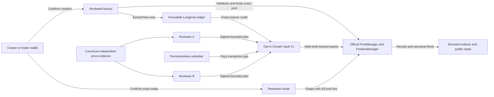

# RMT Launch release candidate

The candidate runs on private loopback chain 31337. Production launch activation, production signing and new deployment are separate approvals. The candidate branch and exact validation commit are recorded in the draft pull request.

## Review stack

| Scope | Review head |
| --- | --- |
| Main preservation baseline | `6d0b8103bdad95367445a38e5f5327458baa9ab2` |
| Launchpad scope reset #576 | `f563870d9933b7cfa2035cdeaa138a5785da244d`, targets main |
| Launchpad V4 base | `ae504c8a6851a96d3a0bda9861551e8ec1d04385` |
| Isolated preview #577 | `65f03800df993a1dbc9f1de9f612d83233b8404d` |
| Guard and Longevity #578 | `f17e2eb3a014976d7adeab78e54ea63191850693` |
| Growth Vault #579 | `50ac0c62e39ce11332025f774d164d72c155b878` |
| Separate CannaCat consumer #575 | `5ee50aa9a776dfa70cc2708ba7fa57394c0b229d`, targets main |

PR #579 completed all 18 checks. Its repository-wide Foundry job reported 528 passed, zero failed and four skipped. The separate browser jobs exercised V1, V2 and Growth. [Foundry job](https://github.com/LandoCrissian/robinhood-meme-terminal/actions/runs/43278658923/job/131393770871), [browser evidence](https://github.com/LandoCrissian/robinhood-meme-terminal/actions/runs/43278658944)

Review the delta from #579 and the inherited engine together. The engine scope includes the V1/V2 factories, V2 initialization guard and deployment, Longevity ledger, Growth Vault and deployer, pinned Uniswap dependencies, wallet transaction journal and settlement verification, indexer and SQLite store, and the five public read operations. The RMT token and curve, other product surfaces and the #575 consumer remain outside this candidate's code delta.

## Authority and threats

| Threat | Invariant and review evidence |
| --- | --- |
| Front-running pool initialization | The guarded key uses only `BEFORE_INITIALIZE`. Only the factory bound to that manager and guard may initialize. A hookless key is a different pool. Review factory deployment atomicity and full-key identity through quotes, receipts and indexing. |
| Wrong chain, recipient, or duplicate wallet submission | Bind each action and recovery to the exact chain, account, calldata, value, pool, and router version. Preserve explicit confirmation, simulation, bounded approvals, deadline, reviewed minimum output and strict settlement. The 2.1.2 path includes a positive per-hop floor. |
| Reorg or mixed RPC data | Verify requested block number and hash. Publish only exact factory receipts and funded custody. Verify the index checkpoint and any provisional launch blocks on public pages, and recheck each detail launch before returning current evidence. |
| Accounting drift, reentrancy or failed increase | Credits reconcile to immutable entitlements and actual payouts. Growth accounting satisfies collected plus harvested equals held plus added separately for both assets. A failed increase rolls back fee harvest, funding and approvals. The nonce advances only on a successful add. |
| Principal withdrawal or reserve redirection | The original position remains factory held. The growth position stays vault held. Growth harvest uses a zero-liquidity decrease and checks custody and liquidity. No mutable owner action, arbitrary call, withdrawal or redirect is exposed. |
| Unavailable or dishonest reference | Confirm source identity, market separation, canonical block, time, liquidity, observation history and agreement. Treat a second RPC reading the same pool as the same market. Missing evidence keeps Growth unavailable and ordinary launches independent. |

## Reviewer operations and recovery

The loopback fixture uses two disposable Anvil accounts. Production operators have yet to be appointed. For a production proposal, identify the two operators and separate their key custody, infrastructure access, evidence gathering and incident escalation. Each must independently inspect the source and proposed caps and refuse to sign if the source cannot be corroborated. A production proposer should publish the reviewed digest, observation and expiration without publishing signing secrets. A submitter pays their own network costs. The vault provides no fee reimbursement or automatic execution.

One key cannot produce a valid plan. Two colluding reviewers can authorize a misleading reference within the contract's execution bounds. The vault enforces caps, deadline, nonce and proximity to spot. The reference's quality depends on the independent validation and reviewers. Restrict operations to one executable digest per nonce. If competing signatures escape, any caller can submit either until one succeeds or they expire. A deferral keeps the nonce available. Reconcile receipt outcome, expiry and current nonce before reissuing.

| Future design | Trust and availability |
| --- | --- |
| Keep immutable 2-of-2 | Smallest authority surface. Lost access to either key can leave reserves held indefinitely. |
| Threshold-signed cancellation | Can invalidate a leaked plan only if cancellation lands first. It requires both original signers and does not restore a lost key. |
| Immutable 2-of-3 | Can continue with one key unavailable. Any two operators can jointly approve a bad plan. |
| Delayed threshold rotation | Can recover reviewer operations if a separately governed recovery threshold survives. It creates a new replacement authority and delay policy to audit. |

Each change to signer authority needs a separately reviewed version and owner decision. A replacement vault cannot recover V1 reserves because the reserve recipient on the original launch is immutable.

## Provenance and draft economics

The local fork is anchored to Base Sepolia block 57648300 and its recorded hash. Verify the manager, position manager, StateView, Quoter, Permit2, router and guard bindings and runtime hashes against the checked-in pins. The router 2.1.2 Base Sepolia address is `0x8702463e73f74d0b6765aBceb314Ef07aCb92650`. The local V2 runtime can select it explicitly. Router 2.0 remains the default compatibility path. [Deployment fixture](../packages/contracts/test/fixtures/rmt-v4-deployment-identities.json), [official deployments](https://developers.uniswap.org/docs/protocols/v4/deployments#base-sepolia-84532), [official API support](https://developers.uniswap.org/docs/trading/swapping-api/supported-chains)

Draft terms include 1 million, 100 million or 1 billion fixed supply, 10–100% to full-range liquidity, 0.001–100 test ETH initial deposit, a 0.30% pool fee and zero RMT creation or swap fee. V2 defaults to all earned LP fees credited to the creator. A Longevity opt-in sets a fixed split. A growth add needs positive tracked reserves of both assets, with up to 100 ETH and 1 billion tokens per plan, plus a positive minimum liquidity output. A plan may bound square-root price deviation by up to 50 bps. This corresponds to an actual price change of about +1.0025% or −0.9975% at the extremes. [Local economics](RMT_LAUNCH_V4_LOCAL.md), [vault accounting](RMT_V4_GROWTH_VAULT.md)

Recorded reserve credits and held balances are distinct from completed adds. Zero activity, one-sided accrual, dust, sustained price movement and higher execution costs can result in no add for an indefinite period. In the tiny-reserve simulation, tracked assets were worth 1,797,299 native wei at the synthetic reference. The add used 434,763 gas measured inside the Foundry call frame. At a hypothetical 20 gwei this is 0.00869526 ETH. The estimate excludes intrinsic gas, deployment, fee collection, L1 data and operator costs. It establishes neither a live cost nor an economically viable add.

The [price validator](../apps/web/lib/server/growth-price-evidence.ts) takes two approved venues with distinct operators and authorities on the target chain. Each adapter must provide a time-weighted observation and the minimum executable two-sided depth within 1% over its window. Draft checks require a 30–120 minute window, at least 12 observations and 5 quote ETH of depth, an observation no older than 120 seconds with at least two confirmations, and at most 30 seconds of source skew. The validator binds block numbers, hashes and timestamps, checks source runtime identities and rejects disagreement above 50 actual-price bps or target spot deviation above 100 actual-price bps. Spot can veto a reference. The reference comes from the corroborated source observations. No approved live registry, adapter or production reviewer operation is configured. The explicit loopback fixture uses a canonical opening observation for at most 120 seconds.

## Independent review coverage

The #579 Slither gate did not generate SlithIR for V1 `_fundPosition`. The pinned analyzer encountered an unresolved `deadline.toUint48()` library call during IR generation. The affected method covers temporary allowance setup and clearing, PositionManager funding, actual balance checks and custody. A focused analysis using only the Growth source also reported the same parsing issue on V2's corresponding method. The full baseline CI log identified V1. Existing success, rounding, custody invariant and fork tests, plus the candidate's failed-funding rollback and retry, provide runtime coverage. Independent review still needs to inspect that method and reconcile the static coverage gap. [Baseline Slither log](https://github.com/LandoCrissian/robinhood-meme-terminal/actions/runs/43278658907)

The candidate's targeted Foundry run passed 40 tests across the V1, V2 and Growth Vault unit and official-contract fork suites, with zero failed or skipped. It included the V1 funding rollback and retry, stale and competing plans, unavailable and compromised keys, repeated failed attempts, dust economics, bounded rounding and the custody invariant. The fork upstream is used only for reads.

The [hosted capture verifier](../scripts/verify-hosted-v4-observation.mjs) validates sanitized Base Sepolia payloads offline. Pass a JSON file with `expected` containing the independently reviewed chain ID, PoolManager, PoolId and full PoolKey. Optional `buy`, `sell` and `poolInfo` fields hold `{observedAt,response}` with an ISO UTC timestamp and a sanitized response from Uniswap Quote or Pool Info. Run `node scripts/verify-hosted-v4-observation.mjs capture.json`. The tool accepts only the reviewed single-hop swap and settlement calldata shape. It sends no requests, authenticates no source and makes no routing or indexing claim. Capture provenance, the official manager runtime, chain finality and any supported independent hosted indexer must be established separately. Uniswap Pool Info and an independent hosted indexer are separate evidence. [Quote schema](https://developers.uniswap.org/docs/api-reference/aggregator_quote), [Pool Info schema](https://developers.uniswap.org/docs/api-reference/pool_info), [community indexer coverage](https://developers.uniswap.org/docs/community/tooling/v4-community-indexer)

## Release checklist

### A. Core launchpad

- [ ] Review the exact candidate commit, independent code review and inherited V1 funding analysis gap.
- [ ] Approve the target chain, deployment and runtime provenance, operator recovery, wallet and durable indexing arrangements, and launch economics.
- [ ] Decide release eligibility using exact-wallet and receipt evidence on the intended chain. Hosted routing and hosted indexing stay unknown until separately observed for that deployment.

### B. Optional Growth Vault

- [ ] Establish approved, independently governed sources for the exact market and measure failure rates in thin and stressed conditions.
- [ ] Appoint both reviewers, establish separate key custody and evidence operations, review continuity and conflict procedures, and approve the execution-cost and reserve policy.
- [ ] Review and decide whether to retain immutable 2-of-2 or commission a separately versioned recovery design. Commission independent vault, ledger and accounting review before approving any release.

The two release decisions are independent. Growth Vault remains unavailable outside the explicit loopback fixture.
