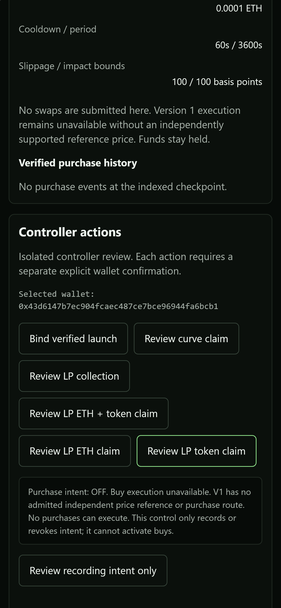
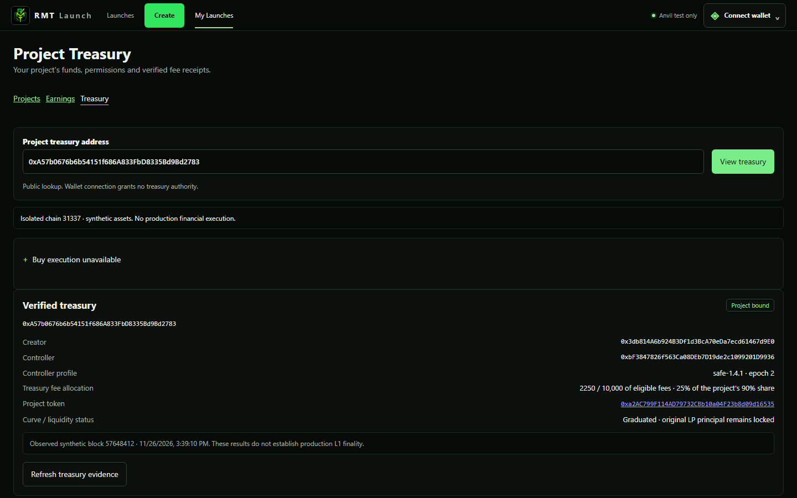

# Treasury purchase V2 acceptance

[Task 077](https://github.com/LandoCrissian/robinhood-meme-terminal/pull/670#issuecomment-6993273913), stacked on #670 at `ecf3998f6e9b556c000de5c48908e4fb0b363fc8`. **NO-GO / NOT EXECUTABLE / BLOCKED_NO_BROADCAST.** No production service, wallet, governance notice, database, royalty recipient, deployed contract or economic rule changed.

## Result and implemented boundary

The separate `treasury-purchase-v2` package is a **local-only, noncustodial route/reference prototype**, not a purchasing treasury ready to deploy. Its factory and constructor reject chain 4663; only synthetic 31337 is admitted. It receives no custody, allowance or spending authority, has no payable entry, and never executes a purchase. It cannot inherit V1's original ledger beneficiary rights or gain swapping through an upgrade/switch. Do not send assets to it: forced ERC-20/ETH transfers have no recovery authority.

It implements deterministic per-treasury CREATE2 identity, exact reviewed runtime bindings, actual active-curve quotations, controller/epoch-bound bounded intent, immediate revocation and explicit reference failure reasons. Controller rotation invalidates old intent automatically. A pinned predecessor is rejected after migration; no route silently follows a new implementation. Source/amount/minimum-output/deadline/cap/slippage/impact checks are useful supporting boundaries, **not proof that execution is safe**. Period-spend and cooldown state do not describe real purchases: none can occur. A future executing version needs reviewed cumulative accounting and settlement/custody, not merely these preflight checks.

The reference reader rejects wrong identity, zero, future, stale, orphaned, same-market, insufficient-history and thin-liquidity observations. All otherwise well-formed observations remain **unadmitted**. Callers can invent their source, history and liquidity fields. The local 60-second/64-block/one-day/2-ETH shape thresholds are development examples, not approved production risk parameters or a new launch mode. Two RPC reads of one pool and a TWAP from that pool do not establish independent pricing. Integer deviation uses token base units per whole ETH; a 1% increase in the square-root ratio is a 2.01% increase in the underlying ratio, not 1%.

The existing creator/treasury interface now says **purchase intent only** and **Buy execution unavailable**. It rejects fabricated V1 execution capability, nonzero purchased counters/timestamps and purchase-execution events. A compact capability panel marks the V2 prototype undeployed/nonexecuting, without inventing balances. Public financial routes remain 404 and the public page makes no wallet request. No hosted redeploy was performed.

## Security disposition

Fresh Slither 0.11.5/Crytic Compile 0.3.11 runs all 101 detectors:

| Exact scope | Findings | High | Gate | Disposition |
| --- | ---: | ---: | --- | --- |
| Existing production 4663 closure | 233 retained | 22 | FAILED | Unchanged core/dependency baseline; not reclassified by this task. |
| Immutable project treasury V1 | 25 | 6 | FAILED | All six IDs freshly reproduced. No reachable loss path established under exact runtime assumptions; internally disputed, **unresolved**, not waived. |
| New nonspending V2 prototype | 3 | 0 | PASSED | Two timestamp lows and one informational creation-template observation. No asset execution is analyzed in this scope. |

The six V1 rows independently cover treasury/sender deposit deltas, treasury/recipient withdrawal deltas, and combined/single-asset LP token settlement. [Individual dataflows, adversaries, preconditions, test identities, remediation choices and residual uncertainty](TREASURY_PURCHASE_V2_SECURITY.md) remain explicit. Thirteen counterfactual hostile-token/ledger tests exercise callback rejection, malformed/false returns, wrong deltas, fee-credit/reservation rollback and custody. These mocks are **not** the admitted fixed-supply Token V2 runtime. Passing a hostile counterfactual does not prove all compositions safe. No confirmed defect justified changing V1; no exact balance assertion was removed or moved to hide it from analysis. An internal reproduction is not an independent audit.

## Robinhood 4663 observation

At block **117745635**, hash `0x89915491572d0a04a77d6d37c842b8742628e934eaee34f99ada478b2b50ce2f`, observed **2026-11-18 22:29:08 UTC**, official and Pocket RPCs corroborated **11 approved runtime pins and 20 bindings/terms**. The factory publication remained scheduled/unexecuted. Existing Safes/protocol deployments were not repeated. These are dated L2 observations; Ethereum L1 finality is not established.

The pinned official Router **2.1.2** is retained. A newer generic router listing is a separate version, not permission to replace the pin. v4 has no built-in oracle; this guard implements initialization permission and no oracle callbacks. Chainlink's observed ETH/USD round/catalog prices the base asset, not an uncreated project. Pyth proxy runtimes exist, but project feed identity, implementation authority and independent market coverage are unadmitted. The conclusion is not that all Robinhood oracles or future routes are unavailable.

**Exact purchase blocker:** no actual new project token has been assigned/created, no funded project pool or independently priced project market is observed, and no defensible independent project-token reference/admission policy exists. A canonical pool ID cannot be invented from a ticker or an absent token. Runtime compatibility alone is not price, liquidity, finality or settlement evidence. [Primary sources, bounded read-only probe, provider limits and full trade-off matrix](TREASURY_PURCHASE_V2_ROUTES.md).

ETH royalty/manual income can be capital only after actual receipt, accounting and permitted-route/reference checks. A token-denominated fee is already inventory of that token: it cannot fund a purchase of itself without another trade. No circular token→ETH→same-token swaps, forced sales, principal spending, buybacks or gas subsidies were introduced. WETH/USDC/arbitrary ERC-20s remain unsupported by V1; external royalties require actual payment-currency compatibility and a separately authorized receiver/payment test. Never redirect royalties based on a proposed address.

## Actual synthetic verification

Both full browser journeys passed at runtime source **`dc6b3d6422245a5da8f631e2fd993a5a36c7c8a5`**. Subsequent changes are evidence, offline probes and documentation. Execution used local **31337**, the retained **Base Sepolia 84532** upstream fixture at block **57648300**, hash `0x5bb29976ce80ddede79f192c61eba8fe9d96f499f8bfa11e0820d11820e91d20`. This is **not** new 4663 financial-fork or physical-iPhone acceptance.

Each Chromium/WebKit run records **53 receipt observations**: 48 existing lifecycle observations plus five zero-value prototype deployment/intent transactions. The eight expected reverts and deliberately orphaned reorg claim remain distinguished. No prototype purchase was submitted. Its fifteen exact-error simulations reject unadmitted/same-curve/stale references, bounds, routes, expiry, epochs, duplicate creation, revoked intent and obsolete routes. All ten prototype checks passed; treasury ETH/token balances and original LP principal stayed intact.

The same run covers new-form opted-out/two-step opted-in creation, 1B supply/zero opening backing, native/token funding, claim recovery, mined out-of-gas rollback, V1→V2→V3 fee continuity, genuine Safe 2-of-3 controller acceptance, real fixture v4 buys/sells, LP fees/claims, PostgreSQL/app restart, reorg credit restoration and noticed token withdrawal. Nine actual Safe executions include two expected failures. Four UI submissions, three recovery cases, two preserved creation archives and seven layouts were verified per engine. A separate real desktop context reads the indexed treasury with no injected wallet.

Other executed checks: **228 website tests**, typecheck/build; **112 core**, **23 V1**, **30 new security/prototype Foundry tests**; 512-run fuzz cases and 4,096-call prototype/V1 invariants; route/security unit tests; PostgreSQL-backed lifecycle/indexer resilience; release evidence/policy/readiness; production dependency audit and credential scans. Public Chromium/WebKit each verify desktop/portrait/landscape, accessible disclosure, no overflow, zero wallet/external/operational requests and three denied financial POSTs. Contract, Firebase-emulator and packaging regressions also run in CI. Consult the PR's **final exact-head** checks; a pending check is not a pass and passing builds do not clear the three retained strict security failures.

## Exact source and retained evidence

All **42 previously tracked Solidity files**, including V1 tests/historical evidence, match the base's exact Git blobs and bytes. Core 31337 input stays `437fb783d7dce558a05317e8b15877f6d08b9571bc12aefec360382469d53648`; V1 stays `513609f57dea2fd706ac749999c47119955be16bb0b4f46a54b9fc4283683cf0`. Approved production constructor/source inputs remain unchanged.

The complete three-source prototype input is **`02d430dc4018a9a75c9c69f204c4e94c57fa8b94722c90effc79293cad7fff7d`**, solc 0.8.26, Cancun, viaIR, 200 optimizer runs, IPFS metadata. Prototype creation/runtime: **8118/6254 bytes**; factory: **9554/9505 bytes**, within EIP-3860/EIP-170. These identities are for nonexecuting local code, not deployable 4663 purchase bytecode.

Raw [compiler/frozen-source manifests, six-row disposition, receipt/database reports and screenshots](evidence/rmt-task077/) are retained. The old Task076 verifier and 190 runtime files are preserved in a checksum-bound archive because authorized UI changes cannot truthfully match the old execution source. The archival test now validates those exact original bytes; old raw reports, screenshot checksums and all settlement assertions remain intact. Fresh Task077 browser/CI evidence tests the changed interface.

Original failed checks are disclosed: the first new invariant setup called a nonexistent `targetContract` cheatcode; it was corrected to Foundry's `targetContracts()` handler interface, preserving the 128×32 run. The historical artifact verifier initially read its newly versioned file instead of its retained original; both original verifier/runtime bytes are now bound. Initial Linux repository CI exposed CRLF-versus-LF source hashing; producer and verifier now use strict UTF-8 and CRLF→LF-only normalization, preserving raw Windows hashes and original RPC observations. Initial Linux WebKit's older default lifecycle reached an unavailable graduation review: the retained diagnostic now identifies **simulation / TimeoutError**, within the existing 2,500ms read-only fixture RPC budget. No graduation was submitted and later profile/treasury stages were skipped in that run. No timeout, assertion or transaction retry was relaxed; final CI re-exercises the unchanged failure-closed behavior. None was a core Solidity defect or a waived financial assertion.

The credential scanner classified the ordinary phrase `publisher/market` in the public research document as a generic key. It also flagged four public synthetic Token V2 addresses and the pinned public token runtime hash in six raw reports (62 rows). Exact literal/path exceptions record these evidenced noncredentials; they do not exempt any contract finding or credential format. Current production-lockfile audit success does not resolve unrelated default-branch Dependabot alerts.

## Reproduce and next boundary

Use Node 22, pnpm 10.12.1, Foundry 1.7.1, checksum-pinned solc 0.8.26, installed pinned core dependencies, PostgreSQL 18 and Playwright 1.55.1.

```sh
pnpm install --frozen-lockfile
(cd packages/contracts && bash scripts/install-v4-deps.sh)
pnpm --filter @rmt/launch-website build
pnpm --filter indexer build
node --test scripts/treasury-v2/*.test.mjs
forge test --root packages/contracts/treasury-purchase-v2 --use /absolute/path/to/solc -vvv
node scripts/visual-qa/rmt-creator-integration.mjs --treasury-only --treasury-v2 \
  --browser chromium --anvil /absolute/path/to/anvil --solc /absolute/path/to/solc \
  --pg-bin /absolute/path/to/postgresql/bin --output /absolute/unused/output
```

Repeat with WebKit and a distinct unused output. `node scripts/treasury-v2/routes.mjs /absolute/unused/routes.json` performs bounded free read-only observations; it never signs/broadcasts. CI adds a fourth separate strict prototype gate without changing the three retained gates.

**Next narrowly scoped decision:** establish a defensible source-admission/funding-asset policy for an actual independently priced project, before designing an asset-bearing purchasing version. If the project lacks that market, keep buying unavailable and use the non-purchasing treasury only under its own release review. An initial purchasing beneficiary must be designed/approved before creation; V1's immutable future credits cannot later be reassigned automatically. No production approval is requested for this completed local work.

LAMMB Genesis royalty settings and reciprocal NFT spending remain separate, unexecuted owner decisions. RMT Reclaim remains an unimplemented, manually funded module ($20 initial pool, $0.05 per eligible retired NFT, later adjustable toward $0.50); no treasury or creator funds are mixed into it. No new wallet, paid keeper, service, plan upgrade, hosted deployment, signature or spending was performed.

| Synthetic phone treasury | Actual desktop read |
| --- | --- |
|  |  |
