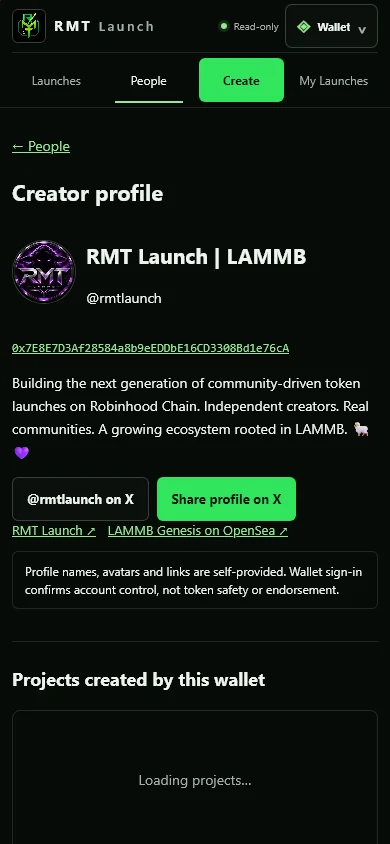
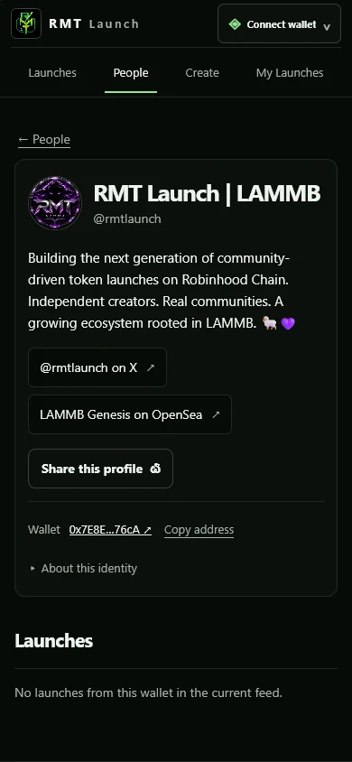

# RMT Launch website review

These captures document the first hosted product candidate. Linux WebKit subsequently found a 4 px overflow in the last navigation label at 320 px. The final review link, artifact identity and captures for the corrected navigation are maintained in [PR #688](https://github.com/LandoCrissian/robinhood-meme-terminal/pull/688).

[Open the hosted preview](https://6b028887d0ada053b279428b--eclectic-valkyrie-16cb92.netlify.app) · [People](https://6b028887d0ada053b279428b--eclectic-valkyrie-16cb92.netlify.app/people) · [Official profile](https://6b028887d0ada053b279428b--eclectic-valkyrie-16cb92.netlify.app/u/rmtlaunch) · [Crawler image](https://6b028887d0ada053b279428b--eclectic-valkyrie-16cb92.netlify.app/share/u/rmtlaunch/b59a8e6b7c91f5608478bc33.png)

Production baseline `9fc88e35` · review website `9ee17521` · Netlify draft `6b028887d0ada053b279428b`. [Exact source, hashes and observations](review.json).

| Before · official profile | After · official profile |
|---|---|
|  |  |

## Browser captures

Each pair shows the production baseline followed by the hosted candidate. Mobile captures use WebKit with an iPhone viewport. Desktop captures use Chromium. Every candidate route returned HTTP 200 and fit its viewport. Draft review followed a local form submission.

| Journey | 320 px | 390 px | 1440 px | Change |
|---|---|---|---|---|
| Launches |  [Before](images/before-320-home.webp) / [After](images/after-320-home.webp) | [Before](images/before-390-home.webp) / [After](images/after-390-home.webp) | [Before](images/before-1440-home.webp) / [After](images/after-1440-home.webp)  | Clear network and creation status. Fresh empty, stale and unavailable feeds have distinct states. |
| People |  [Before](images/before-320-people.webp) / [After](images/after-320-people.webp) | [Before](images/before-390-people.webp) / [After](images/after-390-people.webp) | [Before](images/before-1440-people.webp) / [After](images/after-1440-people.webp)  | The directory shows the public photo, display name and username. The known QA wallet is omitted. |
| Public creator |  [Before](images/before-320-profile.webp) / [After](images/after-320-profile.webp) | [Before](images/before-390-profile.webp) / [After](images/after-390-profile.webp) | [Before](images/before-1440-profile.webp) / [After](images/after-1440-profile.webp)  | The creator’s identity leads. X, OpenSea, sharing and wallet details have distinct placements. |
| Account |  [Before](images/before-320-account.webp) / [After](images/after-320-account.webp) | [Before](images/before-390-account.webp) / [After](images/after-390-account.webp) | [Before](images/before-1440-account.webp) / [After](images/after-1440-account.webp)  | Public profile editing and wallet connection have separate entry points. |
| Token details |  [Before](images/before-320-create.webp) / [After](images/after-320-create.webp) | [Before](images/before-390-create.webp) / [After](images/after-390-create.webp) | [Before](images/before-1440-create.webp) / [After](images/after-1440-create.webp)  | The image precedes the token fields. Financial availability appears beside the draft. |
| Draft review |  [Before](images/before-320-review.webp) / [After](images/after-320-review.webp) | [Before](images/before-390-review.webp) / [After](images/after-390-review.webp) | [Before](images/before-1440-review.webp) / [After](images/after-1440-review.webp)  | The draft flows into the existing fee, recipient and wallet-review protections. |
| My Launches |  [Before](images/before-320-my-launches.webp) / [After](images/after-320-my-launches.webp) | [Before](images/before-390-my-launches.webp) / [After](images/after-390-my-launches.webp) | [Before](images/before-1440-my-launches.webp) / [After](images/after-1440-my-launches.webp)  | Project history and earnings are reachable. Frozen prototypes are absent from navigation. |
| Terms |  [Before](images/before-320-terms.webp) / [After](images/after-320-terms.webp) | [Before](images/before-390-terms.webp) / [After](images/after-390-terms.webp) | [Before](images/before-1440-terms.webp) / [After](images/after-1440-terms.webp)  | The available website actions and wallet responsibilities are explicit. |
| Privacy |  [Before](images/before-320-privacy.webp) / [After](images/after-320-privacy.webp) | [Before](images/before-390-privacy.webp) / [After](images/after-390-privacy.webp) | [Before](images/before-1440-privacy.webp) / [After](images/after-1440-privacy.webp)  | The page explains where drafts, avatars, public artwork and sessions are stored. |
| Risks |  [Before](images/before-320-risks.webp) / [After](images/after-320-risks.webp) | [Before](images/before-390-risks.webp) / [After](images/after-390-risks.webp) | [Before](images/before-1440-risks.webp) / [After](images/after-1440-risks.webp)  | The page documents identity, liquidity, settlement and data-delay risks. |

## Signed-in and sharing checks

The signed-in runs used test wallets, real Firebase emulator sessions and actual stored profile data. The public review contains a dated copy of publicly visible profiles and reads the canonical website’s public discovery feed. Production Firebase sessions remain bound to the production origin.

| View | Evidence |
|---|---|
| Earlier signed-in editor | [Prior editor](images/baseline-editor.webp) · the only difference between this capture’s source and production was the Safari test script. |
| Current signed-in editor | [320 px](images/editor-320.webp) · [390 px](images/editor-390.webp) · [desktop](images/editor-desktop.webp) |
| Owner share and long display name | [First-person share](images/share-owner.webp) · [48-character name with emoji](images/long-name.webp) |
| X | [Delivered crawler card](images/crawler-card.webp) · [X sign-in after the mobile handoff](images/x-iphone.png.webp). X required authentication to view the composer. |

Only the owner’s public data was read. Browser tests used isolated Auth, Firestore and Storage and the designated artwork review store. The preview returned HTTP 404 on the creation, trading and claim preparation endpoints. The production deployment ID was checked before and after the preview upload.
